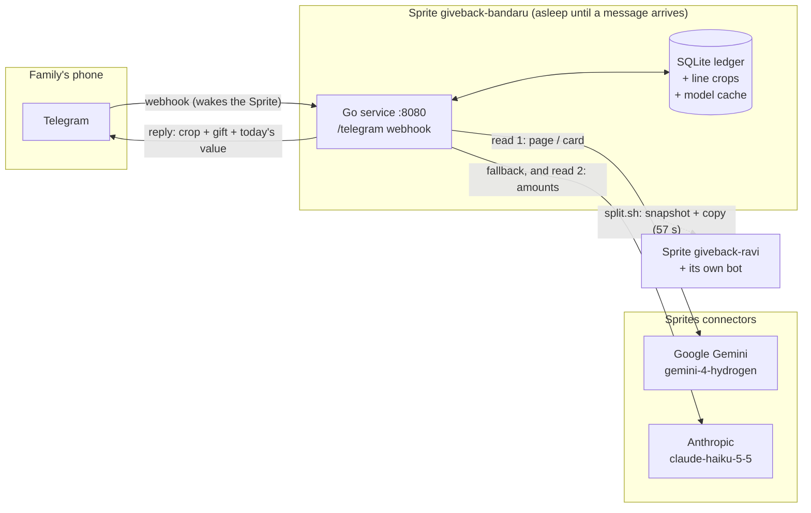

# Giveback

**Your family's gift notebook that never forgets, and wakes up when the invitation arrives.**


Entry for [Fly.io Hacksgiving 2026](https://fly.io/hacksgiving/).

At Telugu, Tamil and Kerala weddings, families write every gift in a notebook: who gave it, how much money or gold, at which function. Years later, when that family invites you, you open the notebook so you can give back at least as much. The habit is called *chadivimpulu* in Telugu and *moi* in Tamil, and in the north it's the "red notebook". The notebooks fade, tear and get lost.

Giveback is a Telegram bot that lives on the family's own Fly.io Sprite:

1. **Photograph the notebook pages once.** It reads the Telugu/English handwriting into a ledger and keeps a cropped picture of every line.
2. **Forward a wedding card when it arrives.** The sleeping Sprite wakes, reads the card's hosts, finds them in the notebook, and replies with the handwritten line, what they gave, when, and what that's worth today.
3. **It understands family words.** "బాబాయి — Rs 216/-" names nobody, but Giveback knows బాబాయి is the father's younger brother and asks *"Is this Bandaru Ramulu?"*. It remembers the answer.
4. **When a child sets up their own home, the notebook splits.** A new Sprite and a new bot get the full history, including what the family already told it, and from then on the two homes grow apart.

**What it will never do:** decide the amount for you, or guess silently. Every answer shows the original handwriting, unsure matches are asked about ("Is this them?"), and amounts that two readings disagree on are shown for you to confirm.

## Demo

<!-- TODO: demo video link + hero screenshot -->

## How it works



- **Reading a page.** Read 1 sends the whole page photo to `gemini-4-hydrogen` and gets back the heading, the date, and every line's text, name, place, amount, gold and a rough box. Model boxes are loose, so each crop is snapped to the ink: it's cut at the emptiest pixel row between lines and widened until the ink stops. Read 2 sends all the crops to `claude-haiku-5-5` with one question: "list every digit of the money at the end of the line". Any disagreement between the two reads, any line the model marks unsure, or any line with no crop is flagged for the family to check. A sideways photo is turned upright and read again.
- **Matching a card to the notebook.** Telugu script and English spellings are reduced to one sound key, so Butham, Bhootham and భూతం all match. Word order doesn't matter, initials support a match but never make one, and a shared surname alone with a different given name is dropped. Relation words (19 of them) are tied to people through a small family tree (`/family father = …`, `/family mother = …`). Only strong matches are stated; weak ones get ✅/❌ buttons, and the answers are remembered by person, in any script.
- **Today's value.** We use the official CPI for Industrial Workers only: yearly averages from the RBI Handbook (Table 34) chained across the 1982, 2001 and 2016 bases with the published linking factors, and the latest Labour Bureau month. Every reply cites the source. Gold is shown by weight (sovereigns and grams), never turned into rupees.
- **Sleep and wake.** Telegram calls a webhook on the Sprite's public URL, so nothing polls and the Sprite sleeps between messages. The service notices when it was frozen and logs how long the Sprite slept and how long the wake took.
- **Splitting a household.** `scripts/split.sh` creates a new Sprite, snapshots the ledger with SQLite `VACUUM INTO` while the old bot keeps running, copies the snapshot over, starts the service and points a second bot at it. It times every phase.
- **Never paying twice.** Every model answer is cached by a hash of the prompt and the image bytes. Photos are deduplicated by hash, and a second photo of the same page is recognised by its line numbers and amounts. Telegram re-deliveries are dropped by update ID.

## Results on real handwriting

Two notebook pages written by hand in Telugu and English (invented entries, with traps on purpose: 116 vs 1,116, the same name in two scripts and word orders, two different Muthyalus, relation words instead of names, gold and gifts with no cash). Scored against [`docs/synthetic-notebook.md`](docs/synthetic-notebook.md):

| Photo | Read 1 / read 2 | Text CER | Amounts right | Flagged (false alarms) | Wrong and not flagged |
|---|---|---|---|---|---|
| page 1 | hydrogen / haiku | 1.4% | 10/10 | 1 (1) | **0** |
| page 2 | hydrogen / haiku | 0.0% | 8/8 | 1 (1) | **0** |
| page 1 turned 90° | haiku / haiku (Gemini busy) | 12.1% | 10/10 | 3 (3) | **0** |

Across every run we made, **no wrong amount ever went unflagged**. The one real misread (Haiku reading "2 కాసులు" as 25) was caught by read 2.

Timings, live: a page takes about 25 s (read 1 is 15–17 s). A typed name lookup answers in 1–2 s. A card answers in 10–17 s when Gemini is quick or fails fast (one hung Gemini call made it 62 s, which is why its timeout is now 25 s). The household split took **57 s**.

Cost: Gemini runs on the free tier ($0). With Haiku as read 2, a page costs about **$0.0008** and a card read by Haiku about **$0.0013**. `/usage` in the bot shows the running totals.

## How we built it

- **[Fly.io Sprites](https://sprites.dev):** one Sprite per household (`sprite create`). The bot runs as a Sprite **service** (`sprite-env services create`) on the Sprite's **public URL**, and Sprite **sleep/wake** means it costs nothing between invitations. We ship it with `sprite exec` and `sprite file push`.
- **Sprites connectors:** **Google Gemini** (`gemini-4-hydrogen`) and **Anthropic** (`claude-haiku-5-5`), granted to the `giveback-` name prefix, so a newly split Sprite reaches both with no extra setup. No API key lives on the Sprite.
- Go (single static binary, fast start), `modernc.org/sqlite` (pure Go, no CGO), the official `anthropic-sdk-go`, and the Telegram Bot API over webhooks with a secret token.
- Built with Claude Code.

## What we learned about Sprites

- **There is no Sprite fork.** We looked through the CLI and the API for fork, clone or "new Sprite from checkpoint" and found nothing. So the household split is `sprite create` plus a consistent copy of the data, and we call it a copy, not a fork.
- **Sleep keeps the process in memory.** A sleeping Sprite freezes the process instead of restarting it: the same process answers after waking, with the same uptime. Our service sees the sleep only as a jump in time. Short sleeps showed up on both the wall clock and the monotonic clock. After a 19-hour idle, the wall clock jumped 19 h but the monotonic clock only 10 min.
- **Sprites sleep fast:** after about 30 s to 2 min idle, even with a service running. Waking costs nothing visible: a message that woke the Sprite had 0 s delivery lag, and the process was running again 3 ms before the request arrived.
- **Connector grants by name prefix cover new Sprites at once.** That makes "one Sprite per household" practical.
- Connector request bodies are capped at 8 MB, and the Gemini Files API isn't forwarded. So we shrink photos and send them inline.
- `sprite file push` needs `-p` for a missing directory, otherwise it reports "directory does not exist".
- Telegram delivers webhook updates for a bot one at a time, in order, and re-delivers after about 60 s. That's why the Gemini timeout is 25 s: a hung call still leaves room for the fallback before the re-delivery.

## Try it yourself

Everything below runs on your own Fly account and your own model keys. About 15 minutes.

**You need:** Go 1.27+, the [`sprite` CLI](https://sprites.dev) logged in to your Fly org (`sprite login`), a Google AI Studio key (the free tier works) and an Anthropic API key.

1. **Make a Telegram bot.** In Telegram, message @BotFather, send `/newbot`, pick a name. Save the token it gives you in a file only you can read:
   ```sh
   mkdir -p ~/.config/giveback && (umask 077; echo 'PASTE_TOKEN' > ~/.config/giveback/bot.token)
   ```
2. **Add the model connectors.** Fly dashboard → **Connectors** → add **Google Gemini** and **Anthropic** with your keys, and grant both to Sprites whose name starts with `giveback-`. Each connector shows a gateway URL: put them in `defaultGeminiBase` and `defaultAnthropicBase` in [`internal/vision/vision.go`](internal/vision/vision.go). No key ever lives on the Sprite.
3. **Make the Sprite and open its URL** (Telegram must be able to reach it):
   ```sh
   sprite create --skip-console giveback-bandaru
   sprite config update -s giveback-bandaru --url-auth public
   ```
4. **Deploy.** This builds the binary, pushes it and the secrets, starts the service on :8080 and sets the Telegram webhook:
   ```sh
   scripts/deploy.sh giveback-bandaru ~/.config/giveback/bot.token
   ```
5. **Fill the notebook with the sample pages.** In your bot's chat:
   - `/start`
   - `/family father = Bandaru Subba Rao`
   - `/family mother = Butham Lakshmi` (her maiden name, surname first)
   - `/pages`, then send [`testdata/notebook/page1.jpeg`](testdata/notebook/page1.jpeg) and [`page2.jpeg`](testdata/notebook/page2.jpeg) **as Files** (sharper than photos). Each takes about 25 s. Then `/done`.
6. **Ask it things.**
   - Type `Bandaru Ramulu`. The notebook never writes that name, only బాబాయి (father's younger brother), so it asks *"Is this Bandaru Ramulu?"* with the handwritten line. Tap ✅ and ask again: it remembers.
   - Send the made-up invitation [`testdata/sample-card.png`](testdata/sample-card.png). It reads the hosts, finds Butham Muthyalu in two lines written in different scripts and word orders, and shows what he gave and what that's worth today. It asks before matching the other Muthyalu (from Chityal) and విమల అత్త.
7. **Optional: split the household.** Make a second bot with @BotFather, save its token as `~/.config/giveback/bot2.token`, then:
   ```sh
   scripts/split.sh giveback-bandaru Bandaru Ravi ~/.config/giveback/bot2.token
   ```
   About a minute later the second bot has the whole notebook, including your ✅ answers. `/start` there tells the story.

Logs: `sprite exec -s giveback-bandaru -- tail -f /.sprite/logs/services/giveback.log`. Running costs: `/usage` in the bot.

Tests make no model calls (`go test ./...`): they replay saved model answers through the real crop, flag and match code.

## What's next

- Typing in new gifts live at a function
- Reminders before a function (Sprites wake only on requests, so this needs an outside timer)
- Choosing between several weddings on the same auspicious date
- Recorded family stories attached to notebook lines
- Scanned pages kept in Box through its connector
- Cards sent as a PDF or as pasted text, such as a WhatsApp invitation message (today only photos of a card are read)
- Tamil, Hindi, Kannada and Malayalam notebooks: the models can read the handwriting, but the matcher only links Telugu script to English spellings, and the 19 relation words it knows are Telugu (బాబాయి, అత్త, మామ…). Each language needs its own script-to-English rules and its own relation words (*chithappa*, *chacha*…)

## Credits

- Demo video music: "Carefree" by Kevin MacLeod (incompetech.com), licensed under Creative Commons: By Attribution 4.0 (https://creativecommons.org/licenses/by/4.0/).
- Notebook handwriting in the demo animation: the Kalam and Mallanna fonts (SIL Open Font License 1.1, via Google Fonts).
